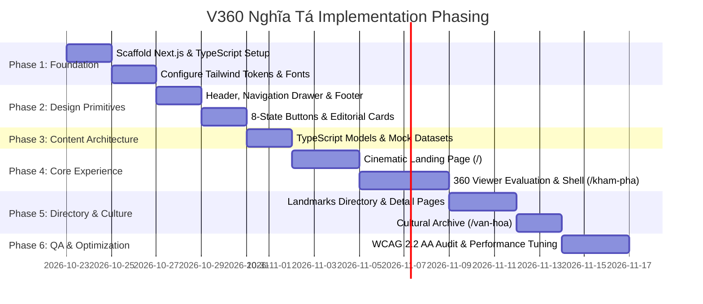

# Implementation Plan: V360 Nghĩa Tá

**Project:** V360 Nghĩa Tá (Chợ Đồn, Bắc Kạn)  
**Document Status:** Phased Engineering Roadmap  
**Target Architecture:** Next.js App Router, TypeScript, Tailwind CSS  
**Version:** 1.0.0  

---

## 1. Phased Implementation Roadmap

---

## 2. Phase-by-Phase Execution Breakdown

### Phase 1: Project Scaffolding & Design Token Setup
- **Goal:** Initialize clean, production-ready Next.js App Router project with TypeScript and Tailwind CSS.
- **Tasks:**
  1. Initialize Next.js in repository root with TypeScript, ESLint, and Tailwind CSS.
  2. Implement design tokens in `tailwind.config.ts` and `app/globals.css` matching [`docs/DESIGN_SYSTEM.md`](file:///docs/DESIGN_SYSTEM.md).
  3. Configure Google Fonts (`Newsreader` / `Playfair Display` for display headings, `Be Vietnam Pro` for body, `JetBrains Mono` for telemetry).
  4. Verify project rules in `AGENTS.md` and installed skills in `.agents/skills/`.

### Phase 2: Base Layout & Interactive Primitives
- **Goal:** Build the global application shell and tactile UI primitives.
- **Tasks:**
  1. Root layout with metadata, `<html lang="vi">`, semantic `<header>`, `<main>`, and `<footer>`.
  2. Mobile navigation drawer with smooth accessibility focus trap and escape key handler.
  3. Interactive primitives: `.btn-heritage` (Primary), `.btn-outline` (Secondary), verification badges (`[ĐÃ XÁC MINH]` / `[DỮ LIỆU THỬ NGHIỆM]`).
  4. Ensure all primitives support the 8-state interactive feedback cycle.

### Phase 3: Content Schemas & Structured Datasets
- **Goal:** Define typed data structures for Points of Interest (POIs), 360 scenes, and cultural stories.
- **Tasks:**
  1. Define TypeScript interfaces:
     - `HeritageSite`: ID, title, slug, category, coordinates, status (`verified` | `unverified`), description, thumbnail, panoramaSceneId.
     - `PanoramaScene`: ID, title, equirectangularImageUrl, initialYaw/Pitch, hotspots.
     - `CulturalArticle`: ID, title, slug, excerpt, contentMarkdown, author/source, readTime.
  2. Create local mock dataset with explicit disclaimers:
     - Clearly label unverified entries as `[DEMO / KHẢO SÁT]`.
     - Use high-fidelity local or CC0 demo panorama assets.

### Phase 4: Cinematic Landing Page (`/`)
- **Goal:** Deliver an emotional, high-craft editorial entrance to Nghĩa Tá.
- **Tasks:**
  1. Hero section: Atmospheric landscape presentation, typography scale, primary CTA into `/kham-pha`.
  2. Curated Explorer section: Asymmetric bento showcase of heritage categories.
  3. Historical & Cultural narrative section: Editorial vignettes respecting ATK history.
  4. Transparent Data Declaration banner.

### Phase 5: 360° Panorama Viewer Evaluation & Integration (`/kham-pha`)
- **Goal:** Provide a smooth, touch-friendly 360° virtual tour shell.
- **Evaluation Mandate:**
  - Evaluate **Pannellum** vs. **Marzipano** based on bundle weight, mobile touch performance, WebGL fallback, and React integration.
  - Wrap the viewer in a client-only component loaded via `next/dynamic` (`ssr: false`) to keep initial page loads instant.
- **Tasks:**
  1. Build viewer container with HUD controls (Compass/Orientation, Fullscreen, Zoom In/Out, Scene Title).
  2. Implement interactive hotspots with accessible popup summaries.
  3. Implement bottom thumbnail drawer for scene switching.

### Phase 6: Directory, Detail & Cultural Archive (`/di-tich`, `/van-hoa`)
- **Goal:** Complete content routes and deep-dive pages.
- **Tasks:**
  1. `/di-tich`: Grid with category tabs and verification status filter.
  2. `/di-tich/[slug]`: Rich editorial detail layout with embedded mini-viewer link.
  3. `/van-hoa`: Cultural article reader.
  4. `/gioi-thieu`: About page detailing methodology and data attribution.

### Phase 7: Accessibility Audit, Performance Optimization & Verification
- **Goal:** Verify compliance with all performance, accessibility, and anti-slop standards.
- **Tasks:**
  1. Run WCAG 2.2 AA audit using `.agents/skills/accessibility-audit/SKILL.md`.
  2. Run Vercel React audit using `.agents/skills/vercel-react-best-practices/SKILL.md`.
  3. Test responsive behavior on mobile (375px), tablet (768px), and desktop (1280px+).
  4. Test `prefers-reduced-motion` compliance.

---

## 3. Dependency Evaluation Matrix

| Dependency | Category | Proposed Role | Status | Evaluation Criteria |
| :--- | :--- | :--- | :--- | :--- |
| **`next`** | Core | Framework (App Router) | **Approved** | Industry standard for Server Components & SEO |
| **`react` & `react-dom`** | Core | UI Library | **Approved** | React 19 / 18 LTS |
| **`typescript`** | Core | Type safety | **Approved** | Strict mode enabled |
| **`tailwindcss`** | Styling | Utility CSS & Token mapping | **Approved** | Zero-runtime CSS |
| **`lucide-react`** | Icons | SVG Vector Icons | **Approved** | Clean, consistent 1.5px/2px vector stroke |
| **`pannellum`** or **`marzipano`** | 360 Viewer | Equirectangular 360 sphere rendering | **Pending Phase 5** | Evaluate bundle size, WebGL touch stability, and mobile memory usage |
| **`motion` (Motion for React)** | Animation | Scroll storytelling & micro-interactions | **Pending Phase 4** | Evaluate whether native CSS transitions suffice before adding JS library |
| **Mapbox / Leaflet** | Map | Spatial exploration | **Deferred** | Only needed if verified GIS/vector data is supplied by local authorities |

---

## 4. Acceptance Criteria & Quality Gates

Before declaring any phase complete:
1. **Compilation & Type Check:**
   - `npx tsc --noEmit` must pass with **0 errors**.
2. **Linting Standards:**
   - `npm run lint` must pass with **0 warnings and 0 errors**.
3. **Responsive Stability:**
   - Viewport tested at 375px, 640px, 768px, 1024px, 1440px.
   - Zero horizontal overflow (`overflow-x`).
4. **Touch & Accessibility Standards:**
   - All interactive controls have minimum $44 \times 44\text{px}$ touch targets.
   - All text contrast ratios $\ge 4.5:1$ (normal) and $\ge 3:1$ (large).
   - Full keyboard navigation verified without mouse.
5. **Core Web Vitals Budget:**
   - LCP $< 2.5\text{s}$ on mobile 4G simulation.
   - INP $\le 200\text{ms}$.
   - CLS $< 0.1$.
6. **Integrity Check:**
   - Zero fabricated historical landmarks or unverified facts presented as truth.
   - All demo assets clearly labeled.
