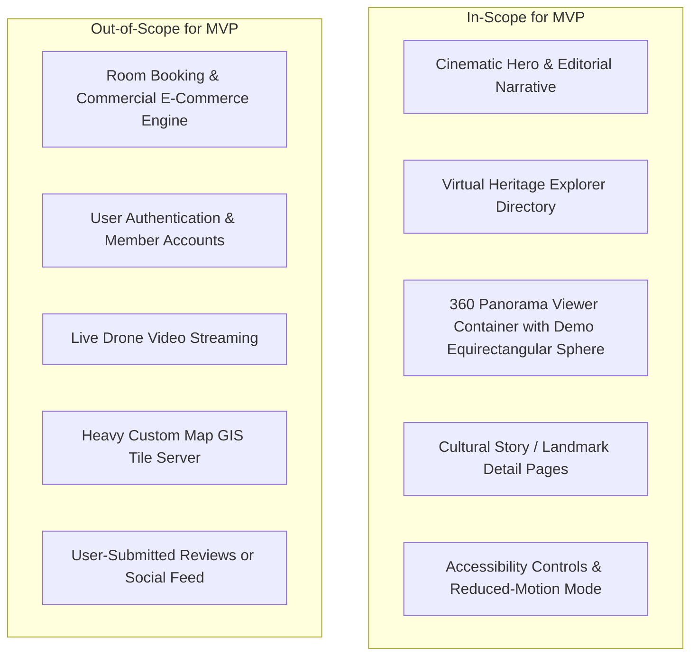

# Project Brief: V360 Nghĩa Tá

**Project Name:** V360 Nghĩa Tá — Interactive Heritage & Virtual Exploration  
**Project Location:** Nghĩa Tá Commune, Định Hóa District, Thái Nguyên Province, Vietnam  
**Version:** 1.0.0 (Foundational Brief)  
**Status:** Approved for Implementation Planning

---

## 1. Project Purpose & Vision

V360 Nghĩa Tá is a digital heritage and cultural tourism web platform designed to preserve, illuminate, and showcase the cultural, historical, and ecological heritage of **Nghĩa Tá** through immersive digital storytelling and interactive 360° virtual tours.

Instead of a noisy, commercial booking directory or generic AI-generated landing page, V360 Nghĩa Tá adopts an **editorial, cinematic heritage-tourism stance** — treating every destination, landmark, and cultural relic with academic respect, narrative depth, and tactile digital craftsmanship.

---

## 2. Target Audience

1. **Cultural Heritage Travelers & Eco-Tourists:**
   - Individuals planning visits to the ATK Định Hóa revolutionary base area and seeking authentic, in-depth cultural narratives before traveling.
2. **Educators, Students & Researchers:**
   - Audiences studying revolutionary history, ethnic minority traditions (Tày, Nùng, Dao), and northern mountainous eco-systems.
3. **Local Community & Northern Diaspora:**
   - People from Thái Nguyên and Nghĩa Tá seeking a digital cultural touchstone that represents their homeland with dignity and pride.
4. **General Digital Explorers:**
   - Users on mobile devices and desktops seeking virtual travel and 360° panorama exploration.

---

## 3. Core Project Goals

- **Cinematic Atmosphere:** Create an immediate emotional connection within the first 5 seconds using typography, authentic imagery, and subtle atmospheric motion.
- **Accessible 360° Exploration:** Offer an intuitive, lightweight virtual Khám phá toàn cảnhmechanism that runs smoothly on standard mobile web browsers without crashing mobile GPUs.
- **Zero Historical Distortion:** Ensure 100% truthfulness in historical records, folklore, and geographical references.
- **Speed & Web Vitals Excellence:** Achieve Sub-2.5s LCP on mobile 4G connections through static generation, optimized next-gen image formats (AVIF/WebP), and lazy loading.
- **Accessibility by Default:** Comply with WCAG 2.2 AA standards across all components.

---

## 4. Documented Assumptions & Open Questions

> [!IMPORTANT]
> The following items represent current working assumptions and open data requests. No unverified geographical, historical, or cultural fact may be stated as definitive truth in the product without human validation.

### Working Assumptions

- **Geographical Scope:** Nghĩa Tá is situated within the mountainous terrain of Định Hóa District, Thái Nguyên Province, having historical ties to the Việt Bắc Safe Zone (ATK Định Hóa - An Toàn Khu) during the Resistance War against French colonialists.
- **Cultural Landscape:** The predominant cultural tapestry includes ethnic communities such as the Tày and Nùng, characterized by traditional stilt houses (_nhà sàn_), folk singing (_Hát Then_), and agricultural livelihoods.
- **Language Priority:** The default language is **Vietnamese** (`lang="vi"`), with architecture prepared for English localization in later phases.

### Open Questions & Unverified Data

- `[UNVERIFIED - DATA ASSET]`: **360° Panoramas:** Exactly which physical locations have been photographed with equirectangular spherical cameras? (The MVP will use calibrated demo panorama assets until official high-res field captures are provided).
- `[UNVERIFIED - HISTORICAL RECORD]`: **Landmark Designations:** Which specific historical sites in Nghĩa Tá hold National or Provincial Monument status? (Exact titles, year of recognition, and historical dossier citations require municipal verification).
- `[UNVERIFIED - GEOLOCATION]`: **Accurate Coordinates:** Exact GPS coordinates for local landmarks, trekking trails, and cultural community houses are pending field measurement.

---

## 5. Technical Constraints

- **Stack:** Next.js (App Router), React, TypeScript (strict), Tailwind CSS.
- **Execution Model:** Static-first or server-rendered presentation; zero heavy backend database or server infrastructure required for MVP.
- **Hosting Target:** Vercel / edge static CDN.
- **Client Performance Budget:**
  - Initial JS bundle $< 120\text{KB}$ (gzip).
  - Heavy 360 viewer libraries (Marzipano or Pannellum) must be deferred and loaded on-demand.
  - Image payloads strictly budgeted ($< 200\text{KB}$ for responsive hero pictures; 360 equirectangular tiles lazy-loaded).

---

## 6. MVP Boundaries

### In-Scope for MVP:

1. **Editorial Landing Page:** Cinematic introduction to Nghĩa Tá's natural and historical landscape.
2. **Heritage Landmark Directory:** Structured list of verified or representative points of interest (with clear placeholder disclaimers where unverified).
3. **Interactive 360° Viewer Shell:** High-performance, touch-friendly 360 viewer with hotspot support, orientation controls, and fullscreen mode.
4. **Cultural Stories & Articles:** Markdown-based editorial long-form articles detailing local traditions and nature.
5. **Universal Accessibility & Navigation:** Clean drawer menu, mobile-first touch ergonomics, and WCAG AA color contrast.

### Out-of-Scope for MVP:

- Booking system, ticketing, payment gateway.
- User accounts, profile login, comment section.
- Real-time weather API integration.
- Custom WebGL map engine (fallback to lightweight SVG or standard static maps).
